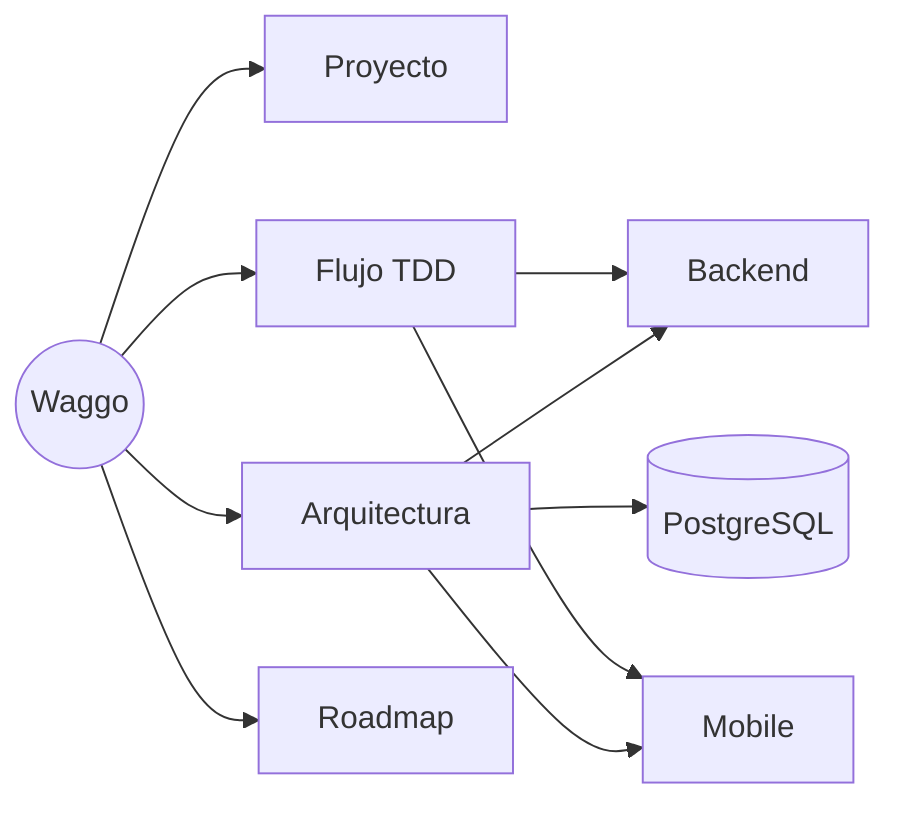

# 🐕 Waggo — Mapa de contenido

> [!abstract] Qué es Waggo
> **Waggo: Plataforma Inteligente para Paseo Seguro de Perros.** App tipo "Uber para paseadores de perros": conecta dueños con paseadores verificados, con rastreo GPS en tiempo real, geocercas, pagos en garantía (escrow) y chat.
> Fuente de verdad de requerimientos: `Requerimientos_App_Paseo_Perros.xlsx` (SRS v1.0, 28/08/2026).

## 1. Proyecto
- [[Visión del proyecto]]
- [[Actores y roles]]
- [[Requerimientos funcionales]]
- [[Requerimientos no funcionales]]
- [[Glosario]]

## 2. Arquitectura
- [[Arquitectura general]]
- [[Backend - Clean Architecture]]
- [[API - Pipeline, seguridad y errores]] — middlewares en orden, excepciones, validación en dos capas, JWT propio + roles, rate limiting, health checks
- [[Frontend - Expo feature-based]]
- [[Base de datos - PostgreSQL]]
- [[Contenedores y despliegue]]
- [[Despliegue en AWS - Guía de operación]] — qué existe en AWS, cómo se publica, rollback y trampas (INF-001, [[ADR-020 Despliegue público en AWS con ECS Fargate y CDK|ADR-020]])
- Decisiones (ADR): [[ADR-001 Repositorios separados]] · [[ADR-002 Clean Architecture en el backend]] · [[ADR-003 Expo y TypeScript]] · [[ADR-004 PostgreSQL con PostGIS]] · [[ADR-005 TDD como flujo obligatorio]] · [[ADR-006 Sin librerías comerciales en el núcleo]] · [[ADR-007 Envolventes WaggoResponse y WaggoApiResponse]] · [[ADR-008 Convenciones de código obligatorias]] · [[ADR-009 Validación de entrada con FluentValidation]] · [[ADR-010 Excepciones custom y middleware centralizado]] · [[ADR-011 Autenticación OAuth 2.0 con roles]] · [[ADR-012 Estructura de carpetas por tipo]] · [[ADR-013 Tema oscuro mobile-first con amarillo y Helvetica|ADR-013 (superada por ADR-018)]] · [[ADR-014 Pasarela de pagos detrás de un puerto]] · [[ADR-015 Selector de tema claro-oscuro]] · [[ADR-016 Identidad propia con bcrypt y JWT emitido por la API]] · [[ADR-017 Login sin 2FA obligatorio y federación OAuth con Google y Microsoft]] · [[ADR-018 Nuevo sistema de diseño Seashell y Sapphire|ADR-018]] · [[ADR-019 Navegación por pestañas y estados de carga con skeletons|ADR-019]] · [[ADR-020 Despliegue público en AWS con ECS Fargate y CDK|ADR-020]] · [[ADR-021 Perfil de usuario como extensión de Identity|ADR-021]]

## 3. Flujo de desarrollo
- [[Flujo TDD]]
- [[Estructura de carpetas del backend]] — dónde va cada cosa (enums, interfaces, helpers, auth…)
- [[Convenciones de código]] — nombres, sin `var`, estilo, Prettier/ESLint (se hacen cumplir en el build)
- [[Convención de respuestas y logging]] — `WaggoResponse`, `ConcatStacks`, `WriteLogs`, `WaggoApiResponse`
- [[Estrategia de pruebas]]
- [[Convenciones de Git y ramas]]
- [[Definition of Done]]
- [[CI-CD]]
- [[Guía AWS SES - prompt de configuración]] — prompt para configurar el envío real de correos con Amazon SES

## 4. Planeación
- [[Roadmap MVP]]
- [[Estado de implementación]] — trazabilidad RF → código
- [[Backlog - Perfil de usuario y panel de administración]] — ideas para desarrollar en paralelo al login social

## Repositorios
| Repo | Contenido | Ruta local | Guía para agentes |
|---|---|---|---|
| `waggo-workspace` | Specs por RF, agentes y skills de Claude Code, README de cada proyecto | `source\repos\Waggo\waggo-workspace` | `CLAUDE.md` + `.claude/` |
| [`Faebb/waggo-api`](https://github.com/Faebb/waggo-api) | Backend .NET 10 + PostgreSQL | `source\repos\Waggo\waggo-api` | `CLAUDE.md` |
| [`Faebb/waggo-mobile`](https://github.com/Faebb/waggo-mobile) | App Expo (iOS / Android / Web) | `source\repos\Waggo\waggo-mobile` | `CLAUDE.md` + `AGENTS.md` |

> [!tip] Vault ↔ código
> El `CLAUDE.md` del workspace (`source\repos\Waggo\`) y el de cada repo apuntan a este vault. Regla: **el código es la fuente de verdad de *cómo* está hecho; el vault, de *qué* y *por qué***. Si un PR cambia una decisión, una regla de negocio o cierra un RF, actualiza la nota correspondiente y [[Estado de implementación]].

