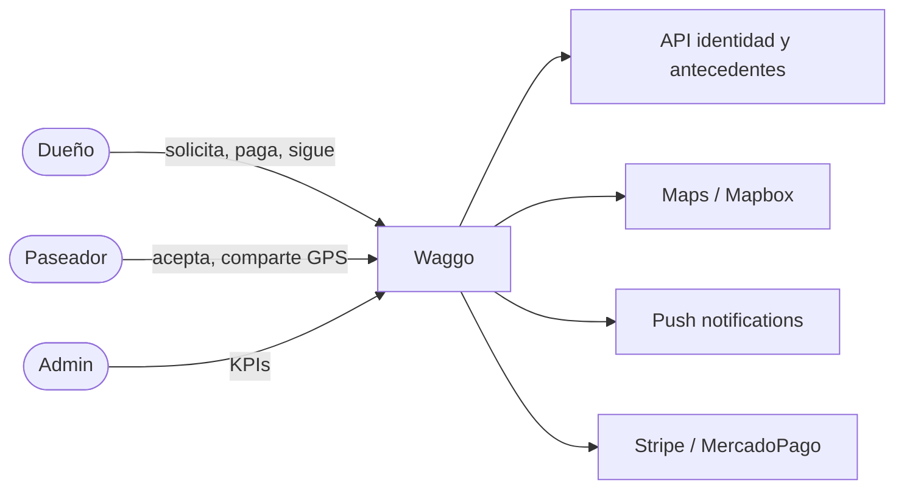

# Actores y roles

Volver a [[00 - MOC Waggo]]

## Actores del sistema
| Actor | Descripción | Rol técnico (claim `role`) |
|---|---|---|
| **Dueño** | Registra mascotas, solicita y paga paseos, sigue el recorrido. | `owner` |
| **Paseador** | Se verifica, acepta paseos, comparte ubicación, recibe pagos. | `walker` |
| **Plataforma** | Procesos automáticos: matching, geocercas, anomalías, escrow, comisiones. | (sistema) |
| **Administrador** | Operación y tablero de KPIs (RF-021). | `admin` |

## Sistemas externos
- Validación de identidad / biometría y antecedentes judiciales (RF-002, RF-003).
- Google Maps / Mapbox (RF-006, RF-008, RF-009, RF-011).
- Notificaciones push — Expo Push / FCM / APNs (RF-007, RF-012, RF-014).
- Pasarela de pagos Stripe / MercadoPago con split payments (RF-015 – RF-018).

## Roles Scrum
- Product Owner: Luis Carlos Medina Moreno.
- Scrum Master: Fauner Echeverri.
- Development team: por conformar.
