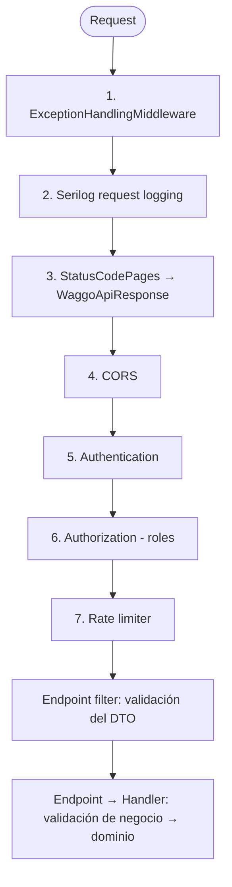

# API — Pipeline, seguridad y errores

Volver a [[00 - MOC Waggo]] · Decisiones: [[ADR-009 Validación de entrada con FluentValidation|ADR-009]] · [[ADR-010 Excepciones custom y middleware centralizado|ADR-010]] · [[ADR-011 Autenticación OAuth 2.0 con roles|ADR-011]] · Relacionado: [[Convención de respuestas y logging]]

## Cómo está organizado `Waggo.Api`
Ver [[Estructura de carpetas del backend]]: `Endpoints/<Módulo>/{Requests, Validators}` e `Infrastructure/{Middleware, Filters, Authentication, Authorization, Responses, Errors, Settings, Extensions, Helpers}`. `Program.cs` solo compone `AddWaggoApi` + `UseWaggoPipeline` + `MapWaggoEndpoints` (en `Infrastructure/Extensions/`).

## Orden del pipeline


| # | Middleware | Por qué va ahí |
|---|---|---|
| 1 | `ExceptionHandlingMiddleware` | El más externo: atrapa las excepciones de todo lo que está debajo. |
| 2 | `UseSerilogRequestLogging` | Una línea de log por request con status y duración. |
| 3 | `UseStatusCodePages` | Los 401/403/404/405/429 sin cuerpo reciben un `WaggoApiResponse`. |
| 4 | `UseCors` | Antes de autenticar: los preflight `OPTIONS` se responden sin token. |
| 5-6 | `UseAuthentication` / `UseAuthorization` | Quién llama y qué puede hacer (roles). |
| 7 | `UseRateLimiter` | Después de autenticar: el límite es por usuario (o por IP si es anónimo). |

## Validación en dos capas
| Capa | Dónde | Qué valida | Cómo se ejecuta | Código de error |
|---|---|---|---|---|
| 1. DTO (depuración) | `Waggo.Api/Endpoints/<Módulo>/Validators/<X>RequestValidator` | Forma del request: obligatorios, formatos, valores permitidos | Endpoint filter `.WithRequestValidation<TRequest>()` antes del endpoint | `Request.Required`, `Request.InvalidValue` |
| 2. Negocio | `Waggo.Application/<Módulo>/<CasoDeUso>/<X>Validator` | Reglas del negocio (rangos permitidos, estado, unicidad...) | Primer paso del handler: `ValidateToResponseAsync` + `ConcatStacks` | `<Módulo>.<Regla>` (ej. `Pricing.InvalidDuration`) |

Después, el **dominio** sigue protegiendo sus invariantes (ej. `WalkDuration.Create`).

Ejemplo (`GET /api/v1/pricing/quote`):
- Sin `walkType` → capa 1 → 400 `Request.Required`.
- `walkType=Skateboard` → capa 1 → 400 `Request.InvalidValue` ("Usa uno de estos valores: Individual, Group.").
- `durationMinutes=20` → pasa la capa 1, falla la capa 2 → 400 `Pricing.InvalidDuration`.

## Errores: híbrido
| Situación | Mecanismo |
|---|---|
| Validación y reglas esperadas (pueden ser varias a la vez) | Errores en `WaggoResponse` → `ToApiResult()` |
| No se puede continuar | **Excepción custom** → `ExceptionHandlingMiddleware` |

| Excepción (`Waggo.Domain/Exceptions`) | HTTP |
|---|---|
| `NotFoundException` | 404 |
| `ConflictException` | 409 |
| `UnauthorizedException` | 401 |
| `ForbiddenException` | 403 |
| `BusinessRuleException` | 422 |
| `ExternalServiceException` | 503 |
| Cualquier otra (no conocida) | 500 |

```csharp
throw new NotFoundException(WalkErrors.NotFound, $"Walk {walkId} not found");
//                          ^ lo que ve el usuario    ^ detalle técnico: SOLO al log
```

> [!important] Qué ve el usuario
> - **Nunca** la excepción real, su tipo, el stack trace ni mensajes internos.
> - Un mensaje en español que dice **cómo resolverlo** (revisa los datos, inicia sesión, espera un momento...).
> - Si el error no se conoce (500): *"Ocurrió un error inesperado. Intenta de nuevo más tarde y, si el problema continúa, comunícate con el administrador indicando el código de seguimiento {traceId}."* El mismo `traceId` va en el log con la excepción completa.

## Autenticación y autorización
- **JWT propio**: la API emite y valida sus propios access tokens JWT (HS256, `Authentication:Jwt:SigningKey`/`Issuer`), sin proveedor OAuth externo — decisión [[ADR-016 Identidad propia con bcrypt y JWT emitido por la API|ADR-016]], que resuelve el "pendiente de proveedor" de [[ADR-011 Autenticación OAuth 2.0 con roles|ADR-011]]. Login directo (sin 2FA, [[ADR-017 Login sin 2FA obligatorio y federación OAuth con Google y Microsoft|ADR-017]]) y refresh rotativo: ver `RF-001-RF-005-identidad-y-login` en [[Estado de implementación]]. Login social (Google/Microsoft) de ADR-017 todavía no está implementado.
- **Roles**: `owner`, `walker`, `admin` (`WaggoRoles`). Políticas: `WaggoPolicies.Owner` (owner o admin), `Walker` (walker o admin), `Admin`.
- **Seguro por defecto**: todo endpoint exige usuario autenticado salvo que diga `AllowAnonymous` (`/auth/{register,confirm,login,refresh}`, health checks, OpenAPI en desarrollo).
- En cada endpoint: `.RequireAuthorization(WaggoPolicies.Owner)`.

### Desarrollo sin autenticación (solo pruebas de integración)
- `appsettings.Development.json` → `Authentication:UseDevelopmentUser = true`: cada request entra como un usuario de desarrollo con los roles configurados (por defecto los tres). No hace falta token.
- Para probar reglas por rol se envía el header `X-Dev-Roles: walker` (o varios separados por coma). Para actuar como otro usuario, `X-Dev-User-Id: otro-dueno` (las pruebas de integración lo usan para verificar que un dueño no ve datos de otro).
- La app mobile **ya no usa estos headers**: desde RF-001+RF-005 se autentica con `/auth/login` (sesión directa, sin 2FA — ADR-017) y envía `Authorization: Bearer <JWT>`, con refresh silencioso; ver [[Frontend - Expo feature-based]].
- Los casos de uso obtienen al usuario con `ICurrentUser` (Application), que la API implementa con `HttpCurrentUser` a partir del claim `sub` (o el id del usuario de desarrollo).
- La API **se niega a arrancar** si el usuario de desarrollo está activo en Production, o si no hay `SigningKey` y el usuario de desarrollo está apagado.

### Usuarios de prueba (solo Development y Testing)
> [!info] DEV-001 · PR api#21 + workspace#22, mergeados a `main` el 2026-10-26. Reemplaza el admin único `Seed:Admin`.

Para probar cada rol con el login real (`POST /auth/login`) sin registrarse ni aprobar a nadie a mano, la API crea al arrancar, después de las migraciones, estas cuentas ya confirmadas (spec `waggo-workspace/specs/DEV-001-usuarios-de-prueba.md`):

| Rol | Correo | Contraseña | Nombre completo | Celular |
|---|---|---|---|---|
| `admin` (+ `owner`) | `admin@waggo.local` | `Admin1234` | Administrador Waggo | 3000000001 |
| `owner` | `dueno@waggo.local` | `Dueno1234` | Laura Gómez | 3000000002 |
| `walker` (+ `owner`) | `paseador@waggo.local` | `Paseador1234` | Carlos Ramírez | 3000000003 |

- El paseador tiene un `WalkerProfile` **aprobado** (CC `1000000003`, revisor `seed`), así que su sesión trae el rol `walker`.
- Se configuran en `Seed:Users:{Admin,Owner,Walker}` de `appsettings.Development.json` (la fábrica de pruebas de integración usa las mismas). Una cuenta sin correo o contraseña se omite.
- Idempotente: si la cuenta o el perfil ya existen, no se tocan (tampoco la contraseña).
- **Nunca en producción**: `DevelopmentUsersSeeder` solo se ejecuta si el ambiente es `Development` o `Testing`, y `ProductionSettingsTests` falla si `appsettings.json` (el que leen los demás ambientes) llega a tener la sección `Seed`.

## Rate limiting
- Ventana fija por usuario (o IP): `RateLimiting:PermitLimit` (100) por `RateLimiting:WindowSeconds` (60).
- Al superarlo: HTTP 429 con `Http.TooManyRequests` ("Espera un momento e intenta de nuevo").
- Los health checks no tienen límite.

## Health checks
| Endpoint | Qué revisa | Uso |
|---|---|---|
| `/health/live` | Que el proceso responde | Liveness (reiniciar el contenedor si falla) |
| `/health/ready` | Dependencias con tag `ready` (PostgreSQL) | Readiness (sacar del balanceador si falla) |

## CORS
Orígenes permitidos en `Cors:AllowedOrigins` (hoy la web local `http://localhost:8081/8082`).

## Pendiente
- Recuperación de contraseña (queda para un spec/slice aparte, ver [[Estado de implementación]]).
