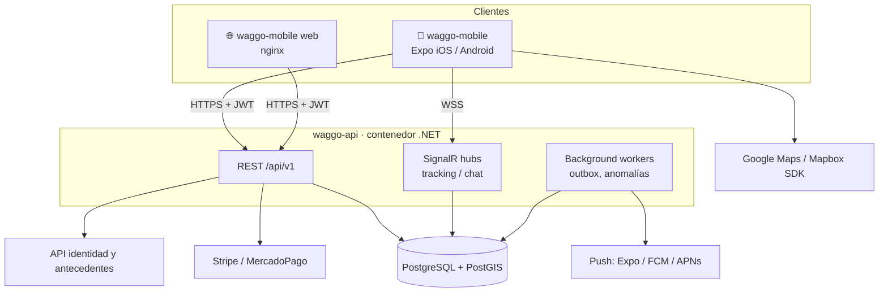

# Arquitectura general

Volver a [[00 - MOC Waggo]]

## Stack
| Capa | Tecnología | Nota |
|---|---|---|
| Mobile / Web | React Native + **Expo** + TypeScript | [[Frontend - Expo feature-based]] |
| API | **.NET 10** (ASP.NET Core Minimal APIs) | [[Backend - Clean Architecture]] |
| Base de datos | **PostgreSQL 17 + PostGIS** | [[Base de datos - PostgreSQL]] |
| Tiempo real | SignalR (WebSockets) | Tracking GPS y chat (RF-008, RF-013) |
| Contenedores | Docker + Docker Compose | [[Contenedores y despliegue]] |
| CI | GitHub Actions | [[CI-CD]] |

## Vista de contenedores (C4 nivel 2)

## Principios
> [!important] Reglas que no se negocian
> 1. **TDD primero**: ningún código de producción sin una prueba que falle antes. Ver [[Flujo TDD]].
> 2. **El dominio no depende de nada**: ni EF Core, ni ASP.NET, ni librerías de terceros.
> 3. **Contrato primero entre repos**: la API publica OpenAPI (`/openapi/v1.json`); el mobile consume ese contrato.
> 4. **Todo corre en Docker**: `docker compose up` debe levantar el entorno completo.
> 5. **Secretos fuera del repo**: `.env` local (ignorado), variables de entorno en contenedores.

## Comunicación entre repos
- Versionado de API por URL (`/api/v1`).
- Cambios que rompen contrato → nueva versión + nota ADR.
- El mobile tiene su propio mock de API en pruebas; la integración real se valida en el entorno Docker.
