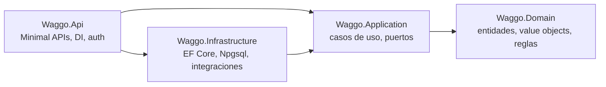
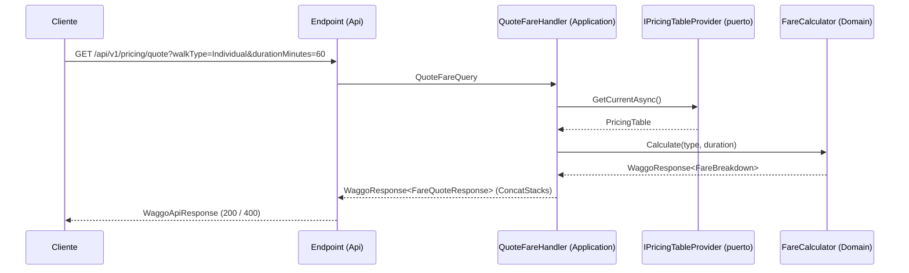

# Backend — Clean Architecture (.NET 10)

Volver a [[00 - MOC Waggo]] · Decisión: [[ADR-002 Clean Architecture en el backend]]

## Capas y dependencias

> [!important] Regla de dependencia
> Las flechas apuntan **hacia adentro**. `Domain` no referencia ningún proyecto ni paquete. Esto lo verifica automáticamente `Waggo.ArchitectureTests` — si alguien la rompe, el build falla.

## Estructura del repositorio
Ver **[[Estructura de carpetas del backend]]** ([[ADR-012 Estructura de carpetas por tipo|ADR-012]]): carpetas por tipo (`Enums`, `Interfaces`, `ValueObjects`, `Services`, `Extensions`…) con subcarpeta por módulo donde crecen; capas como proyectos en la raíz y pruebas en `Tests/`.

## Módulos (bounded contexts)
Para cumplir [[Requerimientos no funcionales|RNF-009]] sin la complejidad de un monolito modular completo, cada capa se organiza en **carpetas por módulo**. Si mañana `Tracking` debe ser un microservicio, sus carpetas se extraen juntas.

| Módulo | RF | Estado |
|---|---|---|
| `Pricing` | RF-018, RF-019 | ✅ Slice de ejemplo implementado con TDD |
| `Identity` | RF-001, RF-002, RF-003, RF-005 | 🟡 Cuenta, 2FA y recuperación de contraseña ✅; verificación de paseadores manual (falta el proveedor) |
| `Pets` | RF-004 | ✅ |
| `Walks` | RF-006, RF-007 | ✅ |
| `Tracking` | RF-008 – RF-012 | ✅ en vivo con SignalR (`/hubs/walks`), polling de respaldo |
| `Messaging` | RF-013, RF-014 | 🟡 Chat (RF-013) y bandeja de avisos (RF-014); falta push |
| `Payments` | RF-015 – RF-018 | 🟡 Con pasarela simulada ([[ADR-014 Pasarela de pagos detrás de un puerto|ADR-014]]) |
| `Analytics` | RF-021 | Pendiente |

## Patrones
| Patrón | Dónde | Por qué |
|---|---|---|
| **Value Object** | `Money`, `CommissionRate`, `WalkDuration` | Reglas de validación en un solo lugar, inmutables, fáciles de probar. |
| **Response envelope** (`WaggoResponse<T>` + `ConcatStacks`) | Todas las capas | Errores, warnings e infos en pilas, sin excepciones de negocio; el endpoint los escribe al log (Serilog) y los envuelve en `WaggoApiResponse`. Ver [[Convención de respuestas y logging]]. |
| **CQRS ligero** | Application | `ICommandHandler<TCommand,TResult>` / `IQueryHandler<TQuery,TResult>` propios, **sin MediatR** (licencia comercial desde v13). Ver [[ADR-006 Sin librerías comerciales en el núcleo]]. |
| **Ports & Adapters** | Application define interfaces, Infrastructure las implementa | Probar casos de uso con dobles (NSubstitute). |
| **Repository + Unit of Work** | Infrastructure (EF Core) | Solo para agregados; las consultas de lectura pueden ir directo a EF. |
| **Domain Events + Outbox** | A partir del módulo `Walks` | Notificaciones y pagos confiables (RNF-008). |
| **Options pattern** | Configuración (`PricingOptions`) | Tarifas y comisión configurables sin redeploy de código. |

## Flujo de una petición

## Seguridad
- **JWT Bearer** (RNF-002): access token de vida corta + refresh token rotativo guardado hasheado.
- **bcrypt** para contraseñas (RNF-001) detrás de `IPasswordHasher`.
- **2FA** (RF-005): TOTP o código por SMS/correo.
- Autorización por roles con `WaggoPolicies.Owner`, `Walker` y `Admin` ([[ADR-011 Autenticación OAuth 2.0 con roles|ADR-011]]).
- Datos sensibles cifrados a nivel de columna (RNF-003).

## Paquetes clave
| Uso | Paquete | Estado |
|---|---|---|
| ORM | `Npgsql.EntityFrameworkCore.PostgreSQL` 10.0 | ✅ |
| PostGIS | `Npgsql.EntityFrameworkCore.PostgreSQL.NetTopologySuite` | ⏳ al crear `Walks`/`Tracking` |
| Nombres | `EFCore.NamingConventions` (snake_case) | ⏳ con la primera entidad |
| Health checks | `Microsoft.Extensions.Diagnostics.HealthChecks.EntityFrameworkCore` | ✅ |
| Autenticación | `Microsoft.AspNetCore.Authentication.JwtBearer` 10.0 ([[ADR-011 Autenticación OAuth 2.0 con roles|ADR-011]]) | ✅ |
| Validación de entrada | `FluentValidation` + `FluentValidation.DependencyInjectionExtensions` 12.0 ([[ADR-009 Validación de entrada con FluentValidation|ADR-009]]) | ✅ |
| Logging | `Serilog.AspNetCore` 9.0 | ✅ |
| Pruebas | xUnit, Shouldly, NSubstitute, coverlet | ✅ |
| Integración | `Microsoft.AspNetCore.Mvc.Testing`, `Testcontainers.PostgreSql` | ✅ |
| Arquitectura | `NetArchTest.Rules` | ✅ |
| Docs API | `Microsoft.AspNetCore.OpenApi` | ✅ |

Versiones centralizadas en `Directory.Packages.props`. Fuente de verdad: el repo.

Relacionado: [[Flujo TDD]] · [[Estrategia de pruebas]] · [[Base de datos - PostgreSQL]]
