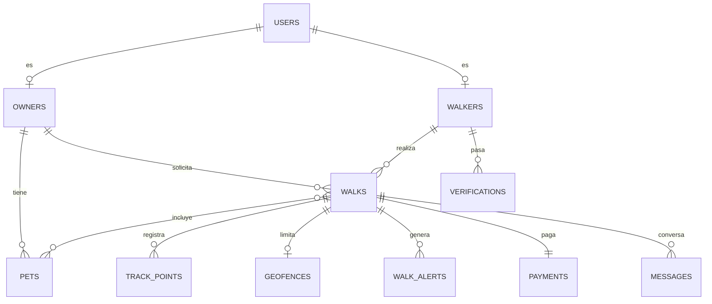

# Base de datos — PostgreSQL + PostGIS

Volver a [[00 - MOC Waggo]] · Decisión: [[ADR-004 PostgreSQL con PostGIS]]

## Decisiones
- Imagen Docker: `postgis/postgis:17-3.5` (PostgreSQL 17 con PostGIS).
- Acceso: **EF Core + Npgsql**, *code-first* con migraciones versionadas en el repo.
- Convención de nombres: `snake_case` para tablas y columnas (`EFCore.NamingConventions` + `UseSnakeCaseNamingConvention()`, activo desde RF-004); un **schema por módulo** (`identity`, `pets`, `walks`, `tracking`, `payments`...). Facilita extraer un módulo a su propia BD (RNF-009).
- Tipos geográficos: `geography(Point, 4326)` para posiciones, `geography(Polygon, 4326)` para geocercas.

## Migraciones
- Se crean con la herramienta local `dotnet-ef` (`dotnet tool restore`; manifiesto `dotnet-tools.json` en `waggo-api`) y viven en `Waggo.Infrastructure/Persistence/Migrations`.
- En **Development y Testing** la API las aplica al arrancar; en otros ambientes se aplican como paso del despliegue.
- Migraciones: `AddPets` → `pets.pets` (RF-004); `AddWalks` → `walks.walks` con PostGIS (RF-007); `AddWalkConcurrency` → `accepted_at` e índice por paseador.

## Consultas espaciales
- RF-006: `WalkRepository.ListRequestedNearAsync` usa `ST_DWithin(pickup_location, punto, metros)` (aprovecha el índice GiST) y ordena por `ST_Distance` sobre `geography`. Como el dominio usa `GeoPoint` con conversor, las consultas espaciales se escriben en SQL con `FromSqlInterpolated`, que incluye `xmin` por ser el token de concurrencia.

## Concurrencia optimista
- `walks.walks` usa la columna de sistema `xmin` como token de concurrencia (`Property<uint>("Version").IsRowVersion()`; Npgsql no crea columna). Si dos paseadores aceptan a la vez, el segundo `SaveChanges` falla y el repositorio lo traduce a `409 Walks.NotAvailable`.

## Cifrado por columna (RNF-003)
- `AesGcmFieldEncryptor` (AES-256-GCM, nonce aleatorio por valor) + `EncryptedStringConverter` de EF Core. La entidad guarda texto plano; la columna solo ve `v1:<base64>`.
- Llave: `Encryption:Key` (32 bytes en base64). En Development viene en `appsettings.Development.json`; en otros ambientes, secreto o variable `Encryption__Key`. La API no arranca sin llave.
- Columnas cifradas hoy: `pets.medical_notes`.

## Modelo preliminar (MVP)

> [!warning] Datos sensibles (RNF-003, RNF-004)
> Documentos, antecedentes e historial médico se cifran por columna. **Nunca** se guardan datos de tarjeta: solo el `payment_intent_id` / token de la pasarela.

## Rendimiento del tracking (RNF-007)
- `track_points` con índice GiST en la geografía y BRIN sobre `recorded_at`.
- Ingesta por lotes desde SignalR; evaluar particionamiento por fecha cuando el volumen crezca.

## Pruebas
Las pruebas de integración usan un PostgreSQL **real** en contenedor (Testcontainers), nunca SQLite ni InMemory: así se prueban PostGIS, constraints y migraciones de verdad. Ver [[Estrategia de pruebas]].
