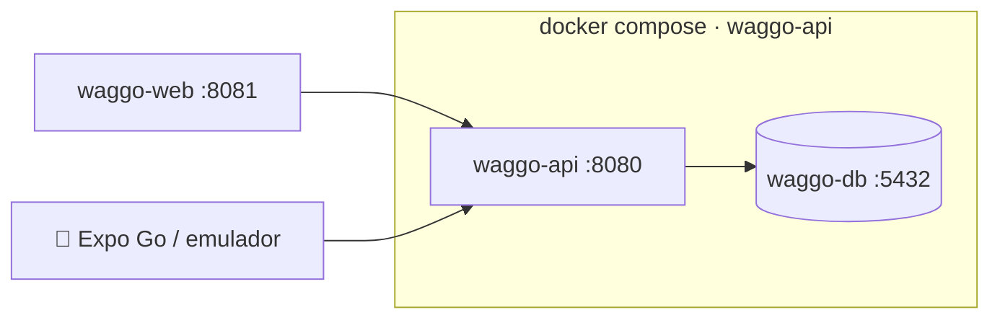

# Contenedores y despliegue

Volver a [[00 - MOC Waggo]]

## Imágenes
| Repo | Imagen | Base | Puerto |
|---|---|---|---|
| waggo-api | `waggo-api` | `mcr.microsoft.com/dotnet/aspnet:10.0` (multi-stage con `sdk:10.0`) | 8080 |
| waggo-api | `postgis/postgis:17-3.5` | — | 5432 |
| waggo-mobile | `waggo-web` | `node:22-alpine` (tests + `expo export`) → `nginx:1.27-alpine` | 80 → 8081 |

> [!note] Mobile en contenedores
> Las apps iOS/Android **no se ejecutan en Docker**: se compilan con EAS Build. Lo que se contenedoriza es la versión **web** (`expo export --platform web`) y el pipeline de pruebas.

## Levantar el entorno local
```bash
# Backend + base de datos
cd waggo-api
cp .env.example .env
docker compose up -d --build
# API:     http://localhost:8080/health/ready
# OpenAPI: http://localhost:8080/openapi/v1.json

# Frontend web
cd ../waggo-mobile
docker build -t waggo-web --build-arg EXPO_PUBLIC_API_URL=http://localhost:8080 .
docker run -p 8081:80 waggo-web
```

## Topología local


## Buenas prácticas aplicadas
- Multi-stage builds, usuario **no root** (`$APP_UID`) en la imagen .NET; los proyectos de pruebas no se copian a la imagen.
- La imagen web corre `npm test` durante el build: **nunca se publica una imagen con pruebas en rojo**.
- Health checks (`/health`) usados por Docker y por el orquestador.
- Configuración solo por variables de entorno (12-factor).
- Imágenes etiquetadas con el SHA del commit en CI.

## Próximos pasos
- Registro de imágenes: GitHub Container Registry (`ghcr.io/faebb/...`).
- Destino del piloto: por decidir (Azure Container Apps, Railway, Fly.io o VPS con Compose).
