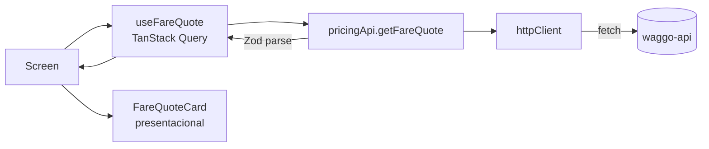

# Frontend — Expo + TypeScript (feature-based)

Volver a [[00 - MOC Waggo]] · Decisión: [[ADR-003 Expo y TypeScript]]

## Stack
| Necesidad | Elección |
|---|---|
| Framework | Expo (SDK 57) + React Native, TypeScript `strict` |
| Navegación | **Expo Router** (rutas basadas en archivos, `src/app/`) |
| Estado de servidor | **TanStack Query** (caché, reintentos, estados de carga) |
| Estado de cliente | **Zustand** cuando se necesite (sesión, preferencias) — ⏳ no instalado aún |
| Validación | **Zod** para validar respuestas de la API |
| Pruebas | **Jest** (`jest-expo`) + **React Native Testing Library** |
| Mapas | Ruta dibujada con `react-native-svg` (sin mapa base). Mapa base con Mapbox o Google — ⏳ cuando el PO elija proveedor |
| Push | `expo-notifications` — ⏳ Sprint 6 |

## Estructura
```text
waggo-mobile/
├─ src/
│  ├─ app/                    # SOLO rutas (Expo Router). Pantallas delgadas que delegan a features.
│  │  ├─ _layout.tsx          # gatekeeper: sin sesión → redirige a /login (excepto rutas públicas)
│  │  ├─ index.tsx            # "/" → bienvenida (UX-001), sin encabezado; "Empezar" lleva a /inicio
│  │  ├─ registro.tsx         # "/registro", confirmar.tsx "/confirmar" (RF-001)
│  │  ├─ login.tsx            # "/login" — entra directo a sesión, sin pantalla de 2FA (ADR-017) (RF-005)
│  │  ├─ (tabs)/               # Barra de pestañas del dueño (ADR-019): inicio, paseos/, mascotas/, configuracion/
│  │  ├─ (walker-tabs)/        # Barra de pestañas del paseador (ADR-019): paseador/index, paseador/configuracion
│  │  ├─ paseos/               # Detalle, empujado sobre las pestañas: "/paseos/nuevo", "/paseos/[id]" (RF-007)
│  │  ├─ mascotas/             # Detalle: "/mascotas/nueva" (RF-004)
│  │  ├─ paseador/             # Detalle del paseador: "/paseador/[id]" (RF-007, rol walker)
│  │  ├─ admin/                # "/admin" → cola de verificación de paseadores, solo rol admin (RF-002/RF-003)
│  │  └─ cotizar.tsx          # "/cotizar" → cotizador de tarifa (RF-019)
│  ├─ features/               # Un folder por módulo de negocio (espejo de los módulos del backend)
│  │  ├─ auth/                # Registro, confirmación por correo, login directo sin 2FA (ADR-017) (RF-001, RF-005)
│  │  ├─ onboarding/          # Bienvenida: sin API, solo screens/components/model (UX-001)
│  │  ├─ home/                # Inicio del dueño estilo Uber (compone pets + walks por su index)
│  │  ├─ pets/                # Mis perros y agregar perro (RF-004)
│  │  ├─ walks/                # Pedir paseo, estado (polling) y mis paseos (RF-007)
│  │  ├─ walker/              # Lado del paseador: solicitudes cercanas, aceptar, iniciar/terminar (RF-007, RF-008)
│  │  ├─ tracking/            # Ruta en vivo (SVG), métricas, envío de la posición y emergencias (RF-008, RF-011, RF-012)
│  │  ├─ messaging/           # Chat del paseo (RF-013)
│  │  ├─ profile/             # Configuración: resumen de cuenta, "Información personal" (nombre/celular), tema, cerrar sesión
│  │  ├─ admin/               # Cola de verificación de paseadores: aprobar/rechazar (RF-002/RF-003)
│  │  └─ pricing/
│  │     ├─ api/              # llamadas HTTP + esquemas Zod
│  │     ├─ hooks/            # hooks de TanStack Query
│  │     ├─ components/       # UI propia de la feature
│  │     ├─ screens/          # pantallas compuestas
│  │     ├─ model/            # tipos y lógica pura (formateo, reglas de UI)
│  │     └─ index.ts          # API pública de la feature
│  ├─ shared/                 # Reutilizable y sin conocimiento de negocio
│  │  ├─ api/              # httpClient.ts (adjunta el JWT y reintenta tras refresh), ApiError.ts
│  │  ├─ auth/              # session.ts (estado de sesión), secureStorage.ts (SecureStore con fallback a AsyncStorage en web), useHydrateSession.ts
│  │  ├─ config/env.ts
│  │  ├─ realtime/         # walkUpdates.ts (una conexión SignalR para la app), useWalkUpdates.ts
│  │  └─ ui/               # Button, ChipGroup, Skeleton (ADR-019, placeholders de carga), theme (colors, fontFamily, typography, spacing, radius)
│  └─ test/                   # utilidades de prueba (render con providers)
├─ Dockerfile                 # build web (expo export) servido con nginx
└─ .github/workflows/ci.yml
```

> [!important] Reglas de dependencia
> - `app/` → `features/` → `shared/`. Nunca al revés.
> - Una feature **no importa archivos internos** de otra feature; solo su `index.ts`.
> - Las pruebas viven junto al archivo que prueban (`formatMoney.ts` + `formatMoney.test.ts`).

## Patrones
| Patrón | Uso |
|---|---|
| Container / Presentational | `screens/` orquesta datos; `components/` solo recibe props → fáciles de probar. |
| Custom hooks | Encapsulan TanStack Query (`useFareQuote`). |
| Adapter de API | `shared/api/httpClient.ts` centraliza base URL, headers, JWT y errores; **desenvuelve el `WaggoApiResponse`** y devuelve `{ data, pagination, warnings, infos, traceId }` o lanza `ApiError` (ver [[Convención de respuestas y logging#Mobile]]). |
| Schema validation | Zod valida la respuesta; si el backend cambia el contrato, falla la prueba y no la app. |

## Flujo de datos


## Diseño visual
Decisión: [[ADR-018 Nuevo sistema de diseño Seashell y Sapphire|ADR-018]] (reemplaza [[ADR-013 Tema oscuro mobile-first con amarillo y Helvetica|ADR-013]]).
- **Mobile first**: columna de máximo 480 px en tablet y web, con la acción principal abajo (sin cambios).
- **Tema claro por defecto** (crema `#FFF0E9`), oscuro disponible por el selector ([[ADR-015 Selector de tema claro-oscuro|ADR-015]]). Acento **zafiro** (`colors.primary`): tono distinto por tema para contraste AA, no un único hex como antes.
- **Baloo 2** (títulos, encabezados, botones) + **Inter** (cuerpo, etiquetas, micro), cargadas con `useFonts` en `_layout.tsx`. Ya no es Helvetica.
- Esquinas más redondeadas (radios 8/14/20/pill); íconos de línea permitidos (ya no "estilo suizo sin íconos").
- Las pantallas solo usan tokens de `src/shared/ui/theme.ts`: `colors`, `typography`, `spacing`, `radius` — por eso el cambio de paleta no tocó pantalla por pantalla.

## Navegación
Decisión: [[ADR-019 Navegación por pestañas y estados de carga con skeletons|ADR-019]]. Barra de pestañas inferior por rol (`(tabs)` dueño, `(walker-tabs)` paseador) con las pantallas de detalle empujadas sobre ella desde el `Stack` raíz; estados de carga con el componente `Skeleton` en vez de `ActivityIndicator`.

## Identidad y sesión
Login real desde RF-001+RF-005 ([[ADR-016 Identidad propia con bcrypt y JWT emitido por la API|ADR-016]], reemplaza la identidad de desarrollo de [[ADR-011 Autenticación OAuth 2.0 con roles|ADR-011]]). `shared/auth/session.ts` guarda `{ accessToken, refreshToken, expiresAt }` en un módulo con `Set<listener>` (mismo patrón que `theme.ts`); `useHydrateSession` lo restaura al abrir la app desde `secureStorage` (`expo-secure-store`, con *fallback* a `AsyncStorage` en web — `expo-secure-store` no tiene implementación real ahí). `httpClient` agrega `Authorization: Bearer <accessToken>` y, ante un 401, intenta un refresh silencioso y reintenta una vez. `_layout.tsx` redirige a `/login` si no hay sesión, salvo en las rutas públicas (bienvenida, registro, confirmación, login — sin paso de verificación por 2FA desde ADR-017).

## Configuración
- `EXPO_PUBLIC_API_URL` define la URL de la API (ver `.env.example`).
- En emulador Android la API local es `http://10.0.2.2:8080`.

Relacionado: [[Flujo TDD]] · [[Estrategia de pruebas]] · [[Backend - Clean Architecture]]
