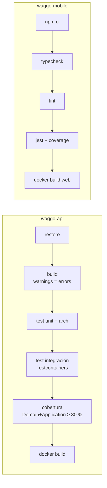

# CI / CD

Volver a [[00 - MOC Waggo]]

Ambos repos incluyen `.github/workflows/ci.yml` (GitHub Actions) que corre en cada PR y en `main`.

## Fases siguientes
| Fase | Qué agrega |
|---|---|
| CD-1 | Publicar imágenes en `ghcr.io/faebb/waggo-api` y `waggo-web` al hacer merge a `main`. |
| CD-2 | Despliegue automático a un entorno *staging*. |
| CD-3 | EAS Build + EAS Update para builds móviles internos (TestFlight / Play interno). |

> [!tip] Protección de rama
> En GitHub → Settings → Branches → `main`: *Require status checks to pass* (jobs `build-test` y `conventional-title`, rama al día), *Require a pull request before merging* (0 aprobaciones mientras haya un solo desarrollador), historial lineal y *Do not allow bypassing the above settings* (aplica también a los admins: nadie hace push directo a `main`). Se aplica con `waggo-workspace/scripts/configure-github.ps1`.
> Solo en `waggo-api` y `waggo-mobile`: son **públicos (MIT)** desde 2026-09-30, porque el plan gratuito de GitHub no permite protección de rama en repos privados. `waggo-workspace` sigue privado y sin protección, pero con la misma política de merge.
> Los workflows de CI corren con `permissions: contents: read`, así un PR externo no recibe un token con escritura.
