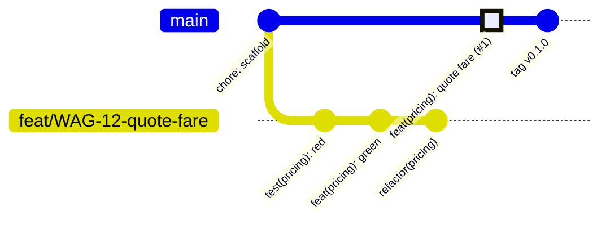

# Convenciones de Git y ramas

Volver a [[00 - MOC Waggo]]

## Estrategia: GitHub Flow (trunk-based ligero)


- `main` siempre desplegable y **protegida**: solo entra por PR con CI verde y 1 aprobación.
- Los PR se integran **solo con Squash and merge**: toda la rama queda como **un commit** en `main` (el resaltado en el diagrama).
- Ramas cortas (< 3 días): `feat/…`, `fix/…`, `chore/…`, `docs/…`, `test/…`, `refactor/…`.
- Nombre con el ID del ticket (Jira/Linear, RNF-011): `feat/WAG-12-quote-fare`.
- Releases con tags SemVer: `v0.1.0`.

## Conventional Commits
```text
<tipo>(<módulo>): <descripción en imperativo>

feat(pricing): calculate fare by walk type and duration
test(pricing): add fare calculator examples from RF-019
fix(tracking): ignore GPS points with low accuracy
```
Tipos: `feat`, `fix`, `test`, `refactor`, `docs`, `chore`, `ci`, `build`, `perf`.

## Squash and merge
> [!important] Regla
> Cada PR entra a `main` como **un solo commit**. Merge commits y rebase merge están deshabilitados en GitHub.

| Dónde | Qué queda |
|---|---|
| Rama del PR | Todos los commits del ciclo TDD: `test(…)` 🔴 → `feat(…)` 🟢 → `refactor(…)` 🔵. Son la **evidencia de TDD** y se revisan en el PR. |
| `main` | Un commit cuyo mensaje es el **título del PR** + su descripción. |

Consecuencias:
- **El título del PR es el mensaje del commit** → debe cumplir Conventional Commits: `feat(pricing): quote fare by walk type and duration (RF-019)`. Lo valida el workflow `pr-title.yml` de cada repo.
- Un commit en `main` = un PR = una funcionalidad → `git revert` limpio y changelog legible.
- La rama se borra automáticamente tras el merge.
- Los commits intermedios de la rama pueden ser pequeños y "feos"; no ensucian `main`.

Configuración en GitHub (*Settings → General → Pull Requests*) de los tres repos, aplicable con `waggo-workspace/scripts/configure-github.ps1`:
- ✅ Allow squash merging · mensaje por defecto: *Pull request title and description*.
- ❌ Allow merge commits · ❌ Allow rebase merging.
- ✅ Automatically delete head branches.
- Protección de `main` (PR obligatorio, CI en verde, historial lineal, también para admins) solo en `waggo-api` y `waggo-mobile`, que son públicos. Ver [[CI-CD]].

## Pull Requests
Plantilla en `.github/pull_request_template.md` de cada repo. El **título** sigue Conventional Commits (será el commit en `main`). La descripción debe incluir:
- RF/historia relacionada.
- Qué pruebas se agregaron (evidencia de TDD).
- Si cambia el contrato de la API → enlazar el PR del otro repo.

Relacionado: [[Definition of Done]] · [[CI-CD]]
