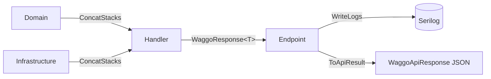

# Convención de respuestas y logging

Volver a [[00 - MOC Waggo]] · Decisión: [[ADR-007 Envolventes WaggoResponse y WaggoApiResponse]] · Estilo: [[Convenciones de código]]

> [!important] Regla del repo
> **Toda operación devuelve un `WaggoResponse<T>`** (dominio, casos de uso, adaptadores). **Todo endpoint responde un `WaggoApiResponse<T>`**. Los métodos **no escriben en el log**: agregan mensajes a las pilas y **quien llama decide dónde se escriben** con `WriteLogs`.



## `WaggoResponse<T>` (interno)
`Waggo.Domain/Common/WaggoResponse.cs` — una sola clase:

| Miembro | Qué es |
|---|---|
| `Data` | El resultado. Solo tiene sentido si `IsValid` es `true`. |
| `Errors`, `Warnings`, `Infos` | Las tres pilas (`List<WaggoMessage>`). |
| `IsValid` | `true` mientras no haya errores. Warnings e infos no la afectan. |
| `ErrorType` | Tipo del primer error (`Validation`, `NotFound`...). Define el código HTTP. |
| `AddError(error)` / `AddError(code, message, type)` | Agrega un error (del catálogo `PricingErrors`, o ad-hoc). |
| `AddWarning(code, message, visibility)`, `AddInfo(...)` | Agrega un warning / info. `visibility` es `Public` por defecto. |
| **`ConcatStacks(other)`** | **Pasa todas las pilas (errores, warnings e infos) de `other` a esta respuesta.** No copia `Data`. |

Cada mensaje es un `WaggoMessage(Code, Message, Visibility)`:
- `Public` → va al cliente y al log.
- `Internal` → solo al log; nunca sale del servidor.

## Cómo se escribe

### Dominio
```csharp
public static WaggoResponse<WalkDuration> Create(int minutes)
{
    WaggoResponse<WalkDuration> response = new();

    if (minutes is < MinMinutes or > MaxMinutes || minutes % StepMinutes != 0)
    {
        response.AddError(PricingErrors.InvalidDuration);
        return response;
    }

    response.Data = new WalkDuration(minutes);
    return response;
}
```

### Caso de uso
El primer paso es validar la entrada con **FluentValidation** ([[ADR-009 Validación de entrada con FluentValidation|ADR-009]]):
```csharp
WaggoResponse<FareQuoteResponse> response = new();

WaggoResponse<QuoteFareQuery> validation = await validator.ValidateToResponseAsync(query, ct);
response.ConcatStacks(validation);
if (!response.IsValid)
{
    return response;
}

WaggoResponse<WalkDuration> duration = WalkDuration.Create(query.DurationMinutes);
response.ConcatStacks(duration);
if (!response.IsValid)
{
    return response;
}

WaggoResponse<PricingTable> table = await pricingTableProvider.GetCurrentAsync(ct);
response.ConcatStacks(table);
if (!response.IsValid)
{
    return response;
}

response.AddInfo(PricingMessages.FareQuoted, "Fare quoted: ...", MessageVisibility.Internal);
response.Data = new FareQuoteResponse(...);
return response;
```
Regla: **cada vez que llamas a algo que devuelve un `WaggoResponse`, haces `ConcatStacks` y revisas `IsValid`.**

### Endpoint
```csharp
WaggoResponse<FareQuoteResponse> response = await handler.HandleAsync(query, ct);
response.WriteLogs(logger, "QuoteFare");
return response.ToApiResult();          // listados paginados: ToPagedApiResult()
```

## Logging
- Serilog es el proveedor; el código usa `ILogger<T>`.
- `response.WriteLogs(logger, "Operacion")` escribe **todas** las pilas: errores → `Error`, warnings → `Warning`, infos → `Information`, con el formato `[Operacion] Codigo: Mensaje`.
- Se llama **una sola vez**, donde tú decidas (normalmente el endpoint). Si lo llamas dos veces, se escribe dos veces.

## `WaggoApiResponse<T>` (lo que ve el cliente)
`Waggo.Api/Infrastructure/Responses/`. Todas las respuestas, también los errores:

```json
{
  "success": true,
  "data": { "walkType": "Individual", "total": 23000 },
  "pagination": null,
  "errors": [],
  "warnings": [],
  "infos": [],
  "traceId": "f315a89b35ea6c2f7e51d0c691c46bbf"
}
```
- `pagination` es `null` si el endpoint no pagina; si pagina: `{ page, pageSize, totalItems, totalPages, hasPrevious, hasNext }` y `data` es la lista de la página.
- Solo salen los mensajes `Public` (`{ code, message }`).

| `ErrorType` | HTTP |
|---|---|
| `None` | 200 |
| `Validation` | 400 |
| `Unauthorized` | 401 |
| `Forbidden` | 403 |
| `NotFound` | 404 |
| `Conflict` | 409 |
| `BusinessRule` | 422 |
| `Unexpected` | 500 |
| `ServiceUnavailable` | 503 |

Lo que no pasa por un endpoint también se envuelve: parámetro con formato inválido → 400 `Request.Invalid`; ruta inexistente → 404 `Http.NotFound`; sin sesión → 401 `Auth.Unauthorized`; sin rol → 403 `Auth.Forbidden`; demasiadas solicitudes → 429 `Http.TooManyRequests`; excepción desconocida → 500 `Server.Unexpected` (pide contactar al administrador con el `traceId`; el detalle solo va al log).

## Paginación
- `PageRequest.Create(page, pageSize)` → `WaggoResponse<PageRequest>`; páginas desde 1, tamaño 20 por defecto, máximo 100.
- El handler devuelve `WaggoResponse<PagedList<T>>`; el endpoint usa `ToPagedApiResult()`.

## Códigos y textos
- Código `Modulo.Descripcion` en inglés (`Pricing.InvalidDuration`); es contrato con el mobile.
- Errores: catálogo en Domain (`PricingErrors`). Warnings/infos: constantes en Application (`PricingMessages`).
- Mensajes `Public` en **español**; `Internal` en inglés.

## Mobile
`httpClient.get(path, schema, params)` valida el envolvente con Zod y devuelve `{ data, pagination, warnings, infos, traceId }`; si `success` es `false` lanza `ApiError` (`status`, `code`, `errors`, `traceId`).

## Excepciones (modelo híbrido)
Los errores que se pueden reportar junto a otros van en `WaggoResponse`. Cuando la operación **no puede continuar** se lanza una excepción custom (`NotFoundException`, `ConflictException`, `ForbiddenException`, `UnauthorizedException`, `BusinessRuleException`, `ExternalServiceException`) y el `ExceptionHandlingMiddleware` responde con el status correcto. Ver [[API - Pipeline, seguridad y errores#Errores: híbrido]] y [[ADR-010 Excepciones custom y middleware centralizado|ADR-010]].

## No hacer
> [!failure] Anti-patrones
> - Lanzar excepciones para validaciones o reglas que se pueden acumular → `AddError`. Excepciones custom solo cuando no se puede continuar.
> - Lanzar `Exception` genéricas o mostrar `exception.Message` al usuario.
> - `logger.LogX` dentro de dominio o casos de uso para reportar un resultado → agrega a las pilas.
> - Llamar otra operación sin `ConcatStacks`.
> - Usar `Data` sin revisar `IsValid`.
> - Devolver `Results.Ok(...)` / `Results.Problem(...)` en un endpoint.

## Pruebas
- Afirmar sobre códigos: `response.Errors.ShouldContain(e => e.Code == "Pricing.InvalidDuration")`.
- Integración: deserializar `WaggoApiResponse<T>` y validar status, `success`, `data`, `errors[].code`.
