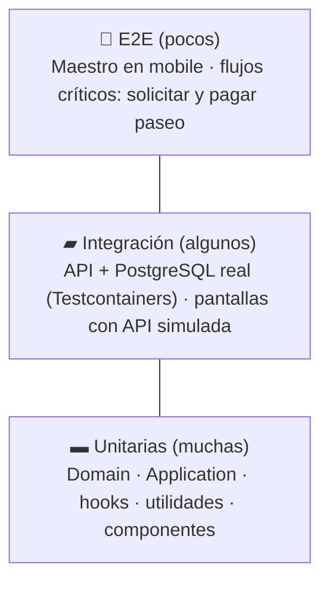

# Estrategia de pruebas

Volver a [[00 - MOC Waggo]] · Proceso: [[Flujo TDD]]

## Pirámide

## Backend
| Proyecto | Qué prueba | Dependencias | Velocidad |
|---|---|---|---|
| `Waggo.Domain.UnitTests` | Value objects, entidades, reglas | Ninguna | ms |
| `Waggo.Application.UnitTests` | Casos de uso | Dobles (NSubstitute) | ms |
| `Waggo.Api.IntegrationTests` | Endpoints HTTP, serialización, auth, EF Core, migraciones | Docker (Testcontainers PostgreSQL) | s |
| `Waggo.ArchitectureTests` | Reglas de capas, RNF-004, RNF-009 | Ninguna | ms |

> [!note] Docker requerido
> `Waggo.Api.IntegrationTests` necesita Docker Desktop corriendo. Para el loop rápido de TDD corre solo las unitarias.

## Mobile
| Tipo | Herramienta | Ejemplo |
|---|---|---|
| Lógica pura | Jest | `formatMoney.test.ts` |
| Cliente API | Jest + `fetch` simulado + Zod | `pricingApi.test.ts` |
| Componentes | React Native Testing Library | `FareQuoteCard.test.tsx` |
| Pantallas | RNTL + QueryClient de prueba | `FareQuoteScreen.test.tsx` |
| E2E | Maestro (a futuro) | Solicitar paseo end-to-end |

> [!tip] Probar como el usuario
> En RNTL se busca por texto visible, rol o `accessibilityLabel` — **no** por detalles de implementación. Eso de paso mejora la accesibilidad.

## Metas de cobertura
| Capa | Mínimo |
|---|---|
| Domain + Application | 80 % líneas |
| Mobile (global, `src/**` sin `app/`, `index.ts` ni `test/`) | 80 % líneas y funciones · 70 % ramas — **bloquea** (`coverageThreshold` en `package.json`) |
| Domain + Application (backend) | 80 % líneas — 🚧 en progreso: bloqueará en CI con `scripts/coverage-gate.sh` (unitarias + integración, unidas con ReportGenerator), aún sin mergear; hoy solo se reporta |
| Backend global (sin migraciones ni código generado) | Se reporta (artefacto `coverage` en CI), no bloquea |

## Qué NO probar
- Código generado (migraciones de EF, `Program.cs` trivial).
- Librerías de terceros.
- Getters/setters sin lógica.

## Pruebas de RNF
| RNF | Prueba |
|---|---|
| RNF-001 bcrypt | Unitaria del `PasswordHasher` |
| RNF-002 JWT | Integración: endpoint protegido devuelve 401 sin token |
| RNF-004 sin tarjetas | Arquitectura (`Domain_NeverStoresCardData_Rnf004`): ninguna propiedad del dominio se llama `CardNumber`, `Pan`, `Cvv`, `Cvc` o `ExpirationDate` |
| RNF-006/007 carga | k6 contra el entorno Docker (antes del piloto) |
| RNF-009 capas | Arquitectura: NetArchTest (`LayerTests`) |
| Convención | Arquitectura: los `*Handler` de Application son `sealed` e `internal` |
