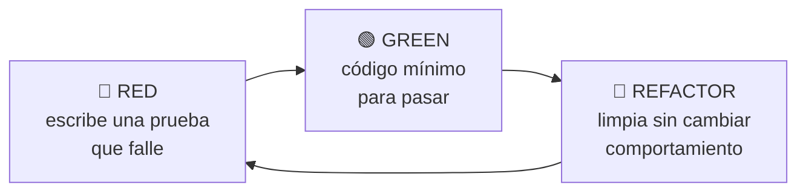
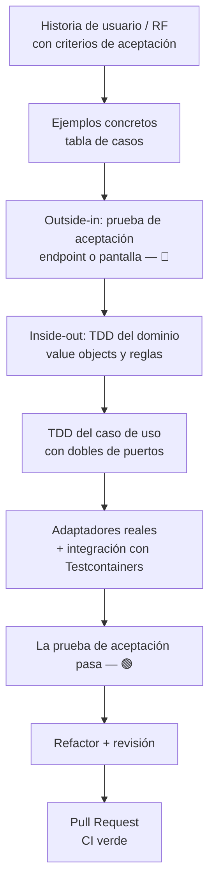
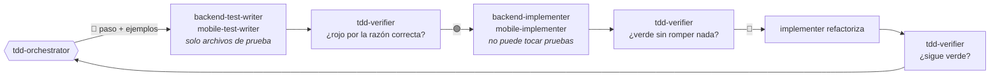

# Flujo TDD

Volver a [[00 - MOC Waggo]] · Decisión: [[ADR-005 TDD como flujo obligatorio]]

## El ciclo


> [!important] Las 3 leyes
> 1. No escribes código de producción sin una prueba que falle.
> 2. No escribes más prueba de la necesaria para fallar (no compilar también es fallar).
> 3. No escribes más código de producción del necesario para pasar la prueba.

## Del requerimiento al PR


1. **Tomar el RF** y convertir sus criterios de aceptación en una tabla de ejemplos (entrada → salida esperada).
2. **Prueba de aceptación en rojo** (doble ciclo / *outside-in*): en el backend, un test de integración del endpoint; en el mobile, un test de la pantalla.
3. **Bajar al dominio** y hacer TDD de las reglas puras (lo más rápido y barato de probar).
4. **Caso de uso** en Application con dobles (NSubstitute) de los puertos.
5. **Infraestructura** real y prueba de integración contra PostgreSQL en contenedor.
6. La prueba de aceptación pasa → **refactor** → PR.

## TDD con agentes de Claude Code
En `waggo-workspace`, cada fase la ejecuta un agente distinto. Así **quien escribe la prueba no es quien la hace pasar**, y un hook impide que cada uno salga de su rol.



| Agente | Fase | Puede escribir |
|---|---|---|
| `tdd-orchestrator` | Planea los ciclos outside-in y decide cuándo avanzar | Nada (delega) |
| `backend-test-writer` / `mobile-test-writer` | 🔴 Red | `waggo-api/Tests/**`, `waggo-mobile/src/**/*.test.ts(x)`, `src/test/**` |
| `backend-implementer` / `mobile-implementer` | 🟢 Green · 🔵 Refactor | Todo **menos** pruebas |
| `tdd-verifier` | Árbitro de cada fase | Nada (solo corre pruebas y git) |

Comandos: `/implement-spec RF-XXX` (spec completa) · `/tdd api "comportamiento"` (cambio puntual o bug).

## Convenciones de pruebas
| Aspecto | Backend (.NET) | Mobile (TS) |
|---|---|---|
| Nombre | `Metodo_Escenario_ResultadoEsperado` | `it('muestra el total cuando…')` |
| Estructura | Arrange / Act / Assert | Arrange / Act / Assert |
| Aserciones | Shouldly | Jest + RNTL (`screen.getByText`) |
| Dobles | NSubstitute | `jest.fn()`, mock de `fetch` |
| Ubicación | proyecto `Tests/Waggo.<Capa>.*Tests` espejo de la capa (en la raíz) | junto al archivo (`*.test.ts[x]`) |

> [!tip] Commits en TDD
> Commits pequeños que cuenten la historia: `test(pricing): ...` (rojo) → `feat(pricing): ...` (verde) → `refactor(pricing): ...`. Viven en la rama como evidencia; al integrar, el PR se hace **squash** y en `main` queda un solo commit. Ver [[Convenciones de Git y ramas#Squash and merge]].

## Comandos
```bash
# Backend
dotnet test                                  # todo
dotnet test --filter "FullyQualifiedName!~IntegrationTests"   # loop rápido sin Docker
dotnet watch test --project Tests/Waggo.Domain.UnitTests

# Mobile
npm test              # una vez
npm run test:watch    # loop TDD
npm run test:coverage
```

## Ejemplo real RF-019
Primer *slice* construido así en ambos repos: **cotización de tarifa** (RF-019) con desglose de comisión (RF-018).

> [!warning] Valores provisionales
> Las tarifas y la comisión son **supuestos** para arrancar; el PO debe validarlas. Están en configuración (`Pricing` en `appsettings.json`), no en el código.

| Tipo | Tarifa base | Por minuto | Duración |
|---|---|---|---|
| `Individual` | $8.000 | $250 | 30–120 min, múltiplos de 15 |
| `Group` | $5.000 | $150 | 30–120 min, múltiplos de 15 |

Comisión plataforma: **20 %** · Redondeo: al múltiplo de **$100** más cercano.

Tabla de ejemplos (las pruebas del dominio salen directo de aquí):

| Tipo | Minutos | Total | Comisión | Paseador |
|---|---|---|---|---|
| Individual | 60 | 23.000 | 4.600 | 18.400 |
| Individual | 30 | 15.500 | 3.100 | 12.400 |
| Group | 45 | 11.800 *(11.750 redondeado)* | 2.360 | 9.440 |
| Individual | 20 | ❌ `Pricing.InvalidDuration` | | |
| Individual | 50 | ❌ `Pricing.InvalidDuration` (no múltiplo de 15) | | |

Recorrido en el backend:
1. 🔴 `FareQuoteEndpointTests` → `GET /api/v1/pricing/quote` devuelve 404.
2. 🔴→🟢 `MoneyTests`, `WalkDurationTests`, `CommissionRateTests`, `FareCalculatorTests`.
3. 🔴→🟢 `QuoteFareHandlerTests` con `IPricingTableProvider` simulado.
4. 🟢 Endpoint + `ConfigurationPricingTableProvider` → la prueba de integración pasa.

Recorrido en el mobile:
1. 🔴 `FareQuoteScreen.test.tsx` — al elegir tipo y duración muestra el total.
2. 🔴→🟢 `formatMoney.test.ts`, `pricingApi.test.ts` (mock de `fetch` + Zod), `FareQuoteCard.test.tsx`.
3. 🟢 Pantalla conectada con `useFareQuote`.

Relacionado: [[Estrategia de pruebas]] · [[Definition of Done]]
