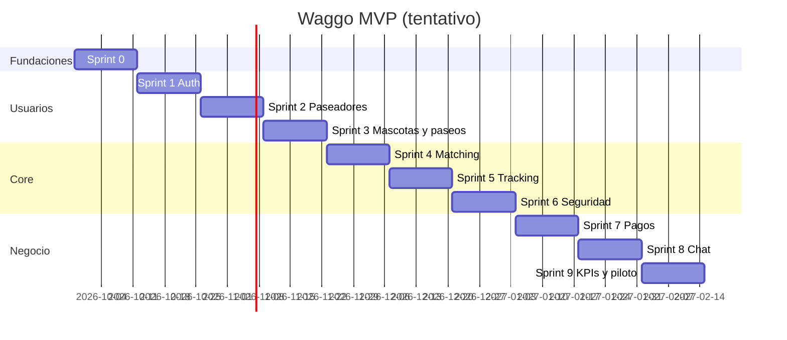

# Roadmap MVP

Volver a [[00 - MOC Waggo]]

> [!note] Propuesta inicial
> Sprints de 2 semanas (RNF-011). El orden prioriza dependencias técnicas y riesgo; el PO puede reordenar.

| Sprint | Objetivo | RF / RNF |
|---|---|---|
| 0 ✅ | Fundaciones: repos, CI, Docker, arquitectura, primer slice TDD (tarifa) — ver [[Estado de implementación]] | RF-019, RF-018 (cálculo), RNF-009, RNF-010 |
| 1 ✅ | Registro y autenticación de dueños con JWT + bcrypt | RF-001, RF-005, RNF-001, RNF-002 |
| 2 | Registro de paseadores + verificación (✅ verificación manual por admin; falta el proveedor) | RF-002, RF-003, RNF-003 |
| 3 ✅ | Mascotas (RF-004) + solicitud y agendamiento de paseo: el dueño pide y el paseador acepta (RF-007) | RF-004, RF-007 |
| 4 | Matching por cercanía (PostGIS) (✅) | RF-006 |
| 5 | Tracking en tiempo real + métricas del paseo (✅ por polling; SignalR 🚧 en progreso, sin mergear) | RF-008, RF-011 |
| 6 | Geocercas, anomalías y emergencia (✅ RF-009, RF-010, RF-012) + notificaciones (✅ bandeja en la app; falta push) | RF-009, RF-010, RF-012, RF-014 |
| 7 | Pagos: pasarela, escrow, split, comisión (✅ adelantado con pasarela simulada; falta el proveedor) | RF-015 – RF-018, RNF-004 |
| 8 | Chat interno (✅ por polling; en vivo con SignalR 🚧 en progreso, sin mergear) | RF-013 |
| 9 | KPIs + pruebas de carga + hardening para piloto | RF-021, RNF-005 – RNF-008 |

## Backlog en paralelo
No están en un sprint todavía — ver [[Backlog - Perfil de usuario y panel de administración]]:
- Perfil de usuario (ver/editar cuenta, proveedores vinculados, eliminar cuenta) — ✅ nombre y celular ya implementados; resto pendiente.
- Panel de administración (aprobar paseadores y ver emergencias sin `curl`).

## Preguntas abiertas para el PO
- [ ] ¿RF-020 existe? (salto en la numeración del SRS).
- [ ] Tipos de paseo definitivos y tarifas reales (hoy: `Individual` / `Group`, valores provisionales).
- [ ] Porcentaje de comisión real.
- [ ] Proveedor de verificación de identidad y antecedentes.
- [ ] Stripe o MercadoPago (disponibilidad de split payments en Colombia).
- [ ] Umbral de detención para anomalías (RF-010). Hoy: 10 min a menos de 30 m; geocerca de 1,5 km (RF-009).
- [ ] Jira o Linear.
